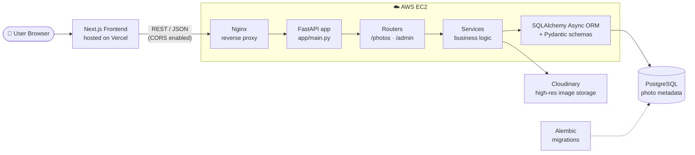
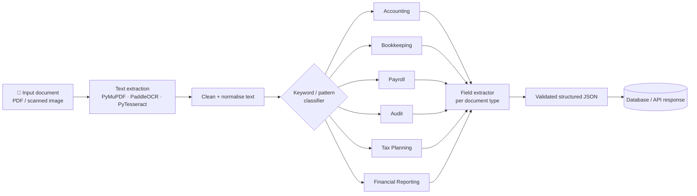

<div align="center">


<br/>


<br/><br/>


</div>

<br/>

## 🖥️ `whoami`

```bash
$ whoami
adwaita-narayan-behera

$ cat profile.json
{
  "role":      "Software Developer Engineer",
  "location":  "Angul, Odisha, India 🇮🇳",
  "focus":     ["Backend APIs", "LLM & RAG systems", "Automation pipelines"],
  "shipped":   "Pixlume → pixlume.online",
  "education": "B.Tech CSE · CGPA 8.10",
  "seeking":   "Entry-level SDE / Python Backend Developer"
}

$ echo $PHILOSOPHY
Clean architecture. Reliable APIs. Production-ready AI.
```

I build **backend services and applied AI systems**: REST APIs with **FastAPI, SQLAlchemy and PostgreSQL**, taken all the way to production on **AWS EC2 + Nginx** and **Vercel**. Across two internships I've shipped hiring-automation engines and OCR + RAG document pipelines.

<br/>

## 🧬 Pixlume Architecture



<br/>

## 🔍 Document Extraction Pipeline



<details>
<summary><b>📋 Document types, trigger keywords and extracted fields</b></summary>
<br/>

| Type | Trigger keywords / patterns | Extracted fields |
|---|---|---|
| **Accounting** | Balance Sheet, P&L, Trial Balance, Debit, Credit, Ledger | Date, Assets, Liabilities |
| **Bookkeeping** | Cash Book, Voucher, Day Book, Journal | Date, Narration, Amount |
| **Payroll** | Salary Slip, Net Pay, PF, TDS, Employee | Month, Name, Net Salary |
| **Audit** | Audit Report, Opinion, Findings, CA, Audit Observations | Company Name, Year, Opinion |
| **Tax Planning** | Section 80C, Investment, Tax Saving, Taxable Income | Income, Tax Plan, Deductions |
| **Financial Reporting** | Q1/Q2 Results, EPS, Revenue, Net Profit, Cash Flow | Period, Revenue, Net Profit |

</details>

<br/>

## 🛠️ Arsenal

<p align="center">
  
</p>

<p align="center">
  
  
  
  
  
  
  
  
</p>

<br/>

## 💼 Experience

<details open>
<summary><b>🧠 AI Developer Intern · Hirekarma Pvt. Ltd.</b> &nbsp;<code>Nov 2025 – Feb 2026</code></summary>
<br/>

- Built REST APIs with **FastAPI, SQLAlchemy and PostgreSQL** for candidate assessments, job roles, reporting and playlists
- Developed AI **question generation, evaluation and scoring engines** for hiring workflows
- Implemented **ATS resume scoring, domain classification** and personalised job-recommendation pipelines

</details>

<details open>
<summary><b>🔍 AI/ML Engineer Intern · AAANS Services Pvt. Ltd.</b> &nbsp;<code>Jul 2025 – Oct 2025</code></summary>
<br/>

- Designed **OCR automation pipelines** (PaddleOCR, PyTesseract, PyMuPDF) to extract structured data from PDFs
- Built **RAG-based PDF Q&A** systems with LangChain + FAISS
- Fine-tuned and evaluated LLMs for domain-specific QA and text classification

</details>

<br/>

## 🚀 Featured Projects

<table align="center">
  <tr>
    <td width="50%" valign="top">
      <h3 align="center">📸 Pixlume</h3>
      <p align="center"><sub><b>LIVE · FULL-STACK</b></sub></p>
      <p align="center">Photography platform to browse, search and download high-res images. Next.js + FastAPI + PostgreSQL, Cloudinary storage, deployed on Vercel and AWS EC2 behind Nginx.</p>
      <p align="center"><a href="https://pixlume.online"></a></p>
    </td>
    <td width="50%" valign="top">
      <h3 align="center">📄 Document Processing System</h3>
      <p align="center"><sub><b>OCR · LLM · RAG</b></sub></p>
      <p align="center">Intelligent document extraction and PDF question-answering using OCR, LangChain and FAISS.</p>
      <p align="center"><a href="https://github.com/AdwaitaNarayan/Data_Analyst_AI_Agent"></a></p>
    </td>
  </tr>
  <tr>
    <td width="50%" valign="top">
      <h3 align="center">🔤 Odia Character Recognition</h3>
      <p align="center"><sub><b>DEEP LEARNING · CV</b></sub></p>
      <p align="center">End-to-end Odia alpha-numeric classifier. EfficientNet-B0, ResNet-50 and SVM models served via REST APIs.</p>
      <p align="center"><a href="https://github.com/AdwaitaNarayan/Odia-Charecter-Recognition"></a></p>
    </td>
    <td width="50%" valign="top">
      <h3 align="center">🧠 Machine Learning Projects</h3>
      <p align="center"><sub><b>PREDICTION · CLASSIFICATION</b></sub></p>
      <p align="center">Prediction, classification and detection models.</p>
      <p align="center"><a href="https://github.com/AdwaitaNarayan/Machine-Learning-Projects"></a></p>
    </td>
  </tr>
</table>

<p align="center"><sub>Also: <a href="https://github.com/AdwaitaNarayan/Python-DSA">Python DSA</a> · data structures and algorithms in Python</sub></p>

<br/>

## 🐍 Contribution Snake

<p align="center">
  <picture>
    <source media="(prefers-color-scheme: dark)" srcset="https://raw.githubusercontent.com/AdwaitaNarayan/AdwaitaNarayan/output/github-contribution-grid-snake-dark.svg">
    <source media="(prefers-color-scheme: light)" srcset="https://raw.githubusercontent.com/AdwaitaNarayan/AdwaitaNarayan/output/github-contribution-grid-snake.svg">
    
  </picture>
</p>

<br/>

## 🌐 Let's Connect

<p align="center">
  <a href="mailto:adwaitanarayan8@gmail.com"></a>
  <a href="https://www.linkedin.com/in/adwaita-narayan-behera/"></a>
  <a href="https://pixlume.online"></a>
  <a href="https://github.com/AdwaitaNarayan"></a>
</p>


